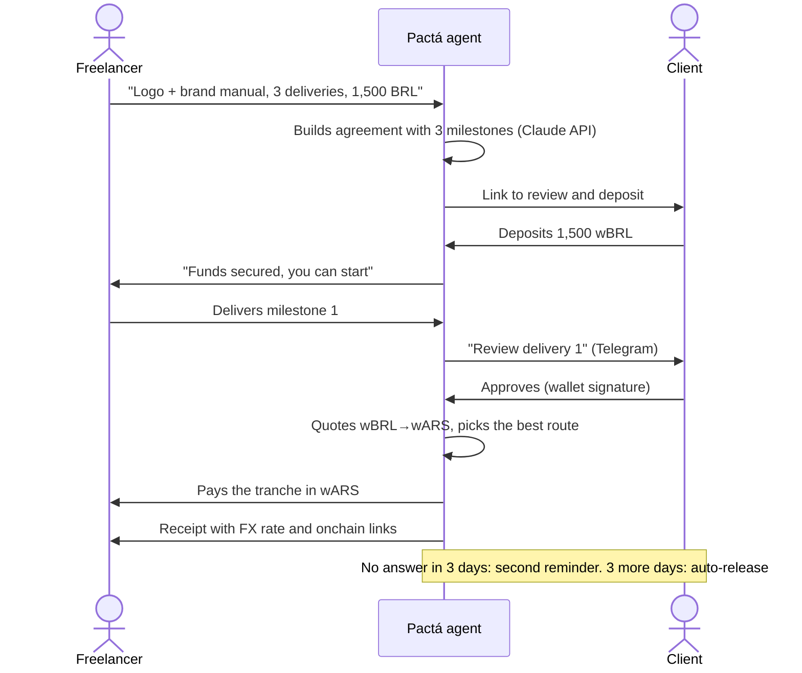
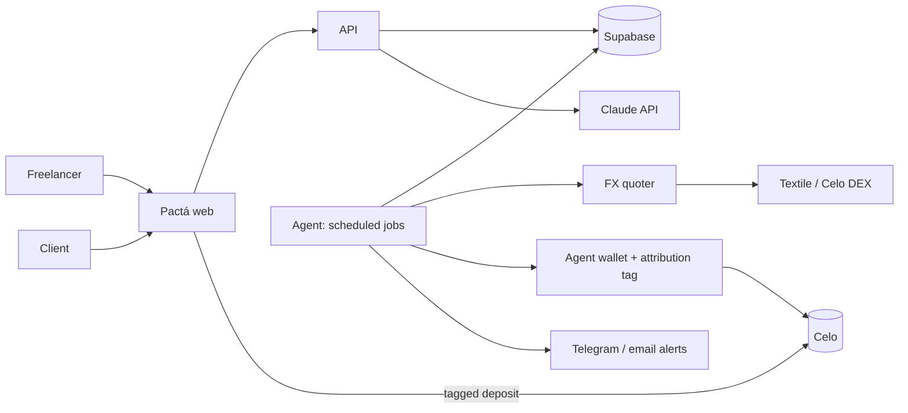

<p align="center">
  <picture>
    <source media="(prefers-color-scheme: dark)" srcset="docs/brand/pacta-logo-oscuro.svg">
    
  </picture>
</p>

<p align="center">
  <b>An AI agent that gets Latin American freelancers paid by milestones, across borders, without going through the US dollar.</b>
</p>

<p align="center">
  Built on Celo · Ripio wFIAT (wARS, wBRL, wMXN) · Textile FX · ERC-8004 · Claude API
</p>

---

> **Status:** built for the [Agents on Open Rails](docs/hackathon/overview.md) hackathon (Loops House × Celo × Ripio). **Live on Celo mainnet** at [pacta-dun.vercel.app](https://pacta-dun.vercel.app): a full milestone payment (deposit → delivery → approval → payout in wARS) has run on mainnet with the team attribution tag, and the agent has an ERC-8004 identity. Cross-currency conversion (Textile / Uniswap) already **quotes** live prices; settling the swap onchain is still in progress, so today the agent pays out in the currency the client deposited. Sections marked *pending* are not done yet.

## The problem

A designer in Córdoba works for an agency in São Paulo. Today she gets paid in dollars: the client converts BRL → USD, she converts USD → ARS, and both lose money on spreads and platform fees. On top of that, she often delivers work and then waits weeks for the invoice to be paid, or it never is.

## What Pactá does

1. **The freelancer describes the job in plain words.** The agent (Claude API) turns it into an agreement with milestones, amounts and review deadlines that she can edit.
2. **The client deposits the full amount upfront**, in their own Ripio stablecoin (for example wBRL). The agent holds it as a guarantee, so the freelancer knows the money is there before she starts.
3. **She delivers a milestone** with a link and a note. The client gets a Telegram message to review it.
4. **The client approves** with a wallet signature (no gas).
5. **The agent gets the best FX quote**, converts that tranche (wBRL → wARS) and pays her. She gets a receipt with the rate, the amounts and the onchain transactions.
6. **If the client doesn't answer**, the agent sends a second reminder after 3 days, and after 3 more days (6 in total) it releases the payment on its own.

Same-currency agreements (wARS → wARS) work too, for clients and freelancers in the same country.



## How it works



| Module | What it does |
|---|---|
| Intake | Free text → agreement with milestones, amounts and deadlines (Claude API). |
| Web | Create agreement, client link, deposit, deliver, approve, receipts. |
| Vault | Detects deposits to the agent wallet and tracks the balance per agreement. |
| FX quoter | Textile + a Celo DEX as fallback, plus a reference rate; picks the best price. |
| Releaser | Pays approved or expired milestones, converting when needed, exactly once. |
| Receipts | Matches database and chain to build a receipt for each payment. |
| Identity & tag | Single wallet client with the attribution tag, ERC-8004 registration, agent card. |
| Alerts | Telegram and email on every state change. |

Milestone lifecycle: `pending → funded → delivered → reminded (day 3) → approved | expired (day 6) → converting → paid`, with `paused` available from `delivered`.

For the MVP the agent wallet acts as the vault, with a cap per agreement and a daily payout cap. An onchain escrow contract is a stretch goal.

## Stack

| Layer | Technology |
|---|---|
| Language | TypeScript (strict) |
| Web + API | Next.js (App Router) on Vercel |
| UI | Tailwind + shadcn/ui |
| Blockchain | viem; wagmi in the browser (MiniPay, Valora, MetaMask) |
| Attribution | `@celo/attribution-tags` (ERC-8021) on every transaction |
| Identity | ERC-8004 Identity Registry on Celo |
| Tokens | Ripio wFIAT: wARS, wBRL, wMXN |
| FX | Textile + Celo DEX fallback |
| AI | Claude API |
| Database | Supabase (Postgres) |
| Scheduled jobs | Vercel Cron |
| Alerts | Telegram (official Bot API) + email with Resend |
| Gas | Paid in CELO by the agent wallet (`feeCurrency` is supported by the wallet client but not used yet) |

## Onchain

| What | Address |
|---|---|
| Network | Celo mainnet (chain 42220) |
| wARS | [`0x0dc4f92879b7670e5f4e4e6e3c801d229129d90d`](https://celoscan.io/token/0x0dc4f92879b7670e5f4e4e6e3c801d229129d90d) |
| wBRL | [`0xd76f5faf6888e24d9f04bf92a0c8b921fe4390e0`](https://celoscan.io/token/0xd76f5faf6888e24d9f04bf92a0c8b921fe4390e0) |
| wMXN | [`0x337e7456b420bd3481e7fa61fa9850343d610d34`](https://celoscan.io/token/0x337e7456b420bd3481e7fa61fa9850343d610d34) |
| ERC-8004 Identity Registry | [`0x8004A169FB4a3325136EB29fA0ceB6D2e539a432`](https://celoscan.io/address/0x8004A169FB4a3325136EB29fA0ceB6D2e539a432) |
| Agent wallet (vault and payer) | [`0xab569A8d8A5b60CFfdf9B88EdE099c80d8328E73`](https://celoscan.io/address/0xab569A8d8A5b60CFfdf9B88EdE099c80d8328E73) |
| Agent ID (ERC-8004) | `10058` (owner: the agent wallet) |
| Agent card | [`pacta-dun.vercel.app/agent-card.json`](https://pacta-dun.vercel.app/agent-card.json) |
| Attribution tag | `celo_dc3ce5f39b37` (team tag, on every transaction the agent and the web send) |
| First real payment on mainnet: deposit (client → agent) | [`0x32a7…f6e0`](https://celoscan.io/tx/0x32a7ef0333f49a5b962cf7d269cafcf1b7f94200717210c26eab4ad8c4d5f6e0) |
| First real payment on mainnet: payout (agent → freelancer) | [`0xbd3c…5ec8`](https://celoscan.io/tx/0xbd3c9924040692c25c9e6c065d473808873cfcc5d916726bb829d7cad9225ec8) |

You can check the tag of any transaction with `NEXT_PUBLIC_CHAIN=celo npm run tag:verify -- <tx hash>` (read-only).

## Run it locally

### 1. Requirements

- **Node.js 22.12 or newer.** The exact version is in [`.nvmrc`](.nvmrc); with [nvm](https://github.com/nvm-sh/nvm) (or [nvm-windows](https://github.com/coreybutler/nvm-windows)) run `nvm install` and `nvm use`. Check it with `node -v`.
- **Git.**
- Optional, only for the parts that touch the chain: a browser wallet (MetaMask, Valora or MiniPay) on Celo Sepolia.

### 2. Get the code

```bash
git clone https://github.com/marianelavflora/pacta.git
cd pacta
npm install
```

### 3. Environment variables

```bash
cp .env.example .env.local
```

Fill in `.env.local`. Git ignores it, so your keys never reach the repo. Every variable has a comment in [`.env.example`](.env.example); this is where each value comes from:

| Variable | Where to get it |
|---|---|
| `NEXT_PUBLIC_CHAIN` | Leave `celo-sepolia` (testnet). `celo` is mainnet. |
| `NEXT_PUBLIC_ATTRIBUTION_TAG` | The team's attribution tag (see [`AGENTS.md`](AGENTS.md)). |
| `AGENT_PRIVATE_KEY` | Agent wallet key. Only the maintainer has it; leave it empty unless you work on payments. |
| `SUPABASE_URL` | Supabase → Project Settings → Data API → Project URL. |
| `SUPABASE_SERVICE_ROLE_KEY` | Supabase → Project Settings → API Keys → the **secret** key (`sb_secret_...`) or the legacy `service_role`. Never the publishable/anon key. |
| `SUPABASE_DB_URL` | Supabase → **Connect** → Connection string. Only needed to run migrations from scripts. |
| `ANTHROPIC_API_KEY` | [console.anthropic.com](https://console.anthropic.com) → API Keys. |
| `TELEGRAM_BOT_TOKEN` | The bot token from [@BotFather](https://t.me/BotFather). See [`docs/telegram.md`](docs/telegram.md). |
| `RESEND_API_KEY` | [resend.com](https://resend.com) → API Keys. |
| `CRON_SECRET` | Any long random string, for example `openssl rand -hex 32`. |
| `TIME_UNIT` | `days` (real deadlines) or `minutes` (to test reminders and auto-release fast). |

You only need the variables of the part you are working on: the home page runs with an empty `.env.local`.

**Test CELO.** To try deposits on testnet, get free CELO for your wallet at [faucet.celo.org](https://faucet.celo.org) (pick Celo Sepolia). It is play money with no real value.

### 4. Database

The tables live in [`supabase/migrations/`](supabase/migrations/). To create them in your Supabase project:

1. Open Supabase → **SQL Editor** → **New query**.
2. Paste the content of each file **in order** (`0001_...`, then `0002_...`, and so on) and click **Run**.
3. Check them in **Table Editor**: `users`, `agreements`, `milestones`, `movements`, `quotes`.

The migrations are safe to run more than once.

### 5. Run it

```bash
npm run dev     # app at http://localhost:3000
npm test        # tests (Vitest)
npm run lint    # code style (ESLint)
npm run build   # production build, the same one Vercel runs
```

Before opening a PR, `npm run lint`, `npm test` and `npm run build` must pass.

### Common problems

| Problem | Fix |
|---|---|
| `npm install` fails or warns about `engines` | Your Node is too old. Run `nvm use` (or install Node 22.12+) and try again. |
| `npm run dev` says port 3000 is in use | Another app is using it. Close it, or open the URL Next.js prints (usually `http://localhost:3001`). |
| A variable is `undefined` | Check the name matches `.env.example`, the file is called `.env.local` (not `.env.local.txt`) and sits in the project root. Restart `npm run dev` after changing it. |
| Supabase says `Invalid API key` or `permission denied` | You used the publishable/anon key. Use the secret (`sb_secret_...`) or `service_role` key. |
| SQL Editor says a table does not exist | You ran the migrations out of order. Run them again from `0001`. |
| The wallet shows no CELO on testnet | Make sure it is on Celo Sepolia, not mainnet, and ask the faucet again. |
| Something is odd after pulling new changes | Delete `node_modules` and `.next`, then run `npm install` again. |

If you get stuck, ask in the team chat with the exact error message. The team workflow (branches, PRs) is in [`docs/WORKFLOW.md`](docs/WORKFLOW.md), in Spanish.

## Demo

*Pending (PAC-52).* Link to the 2–3 minute video of a real cross-border payment on mainnet.

## Team

| | Focus |
|---|---|
| Mavi ([@marianelavflora](https://github.com/marianelavflora)) | Agent, wallet, blockchain, payments, FX, AI |
| Flor | Frontend: UI, wallet connection, views, receipts, mobile |
| Leila ([@leispini](https://github.com/leispini)) | Database, API, FX research, tests |
| Clau ([@ClaudiaRivero863](https://github.com/ClaudiaRivero863)) | Forms, intake UI, Telegram, email, "How it works" page |

## Docs

- [`docs/PLAN.md`](docs/PLAN.md): the living development plan (in Spanish).
- [`AGENTS.md`](AGENTS.md): context and rules for the team and for AI agents working in this repo.
- [`docs/README.md`](docs/README.md): index of all the documentation.

## License

[MIT](LICENSE)
