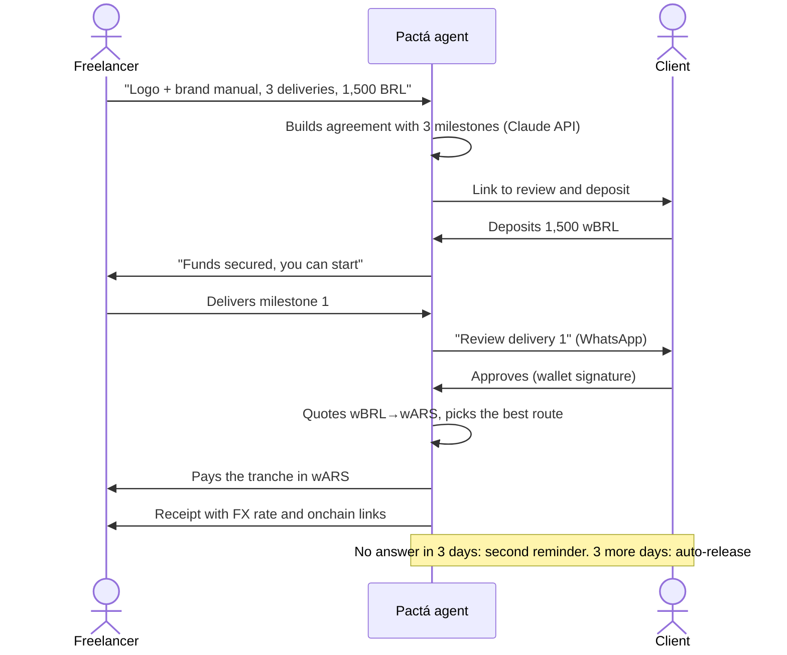
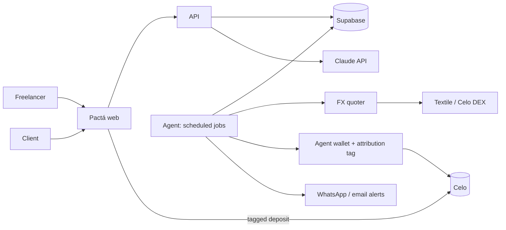

  <picture>
    <source media="(prefers-color-scheme: dark)" srcset="docs/brand/pacta-logo-oscuro.svg">
    
  </picture>

  <b>An AI agent that gets Latin American freelancers paid by milestones, across borders, without going through the US dollar.</b>

  Built on Celo · Ripio wFIAT (wARS, wBRL, wMXN) · Textile FX · ERC-8004 · Claude API

---

> **Status:** in development for the [Agents on Open Rails](docs/hackathon/overview.md) hackathon (Loops House × Celo × Ripio). We develop on Celo Sepolia (testnet) and switch to Celo mainnet on 4 Nov 2026. Sections marked *pending* are filled in as the tickets land.

## The problem

A designer in Córdoba works for an agency in São Paulo. Today she gets paid in dollars: the client converts BRL → USD, she converts USD → ARS, and both lose money on spreads and platform fees. On top of that, she often delivers work and then waits weeks for the invoice to be paid, or it never is.

## What Pactá does

1. **The freelancer describes the job in plain words.** The agent (Claude API) turns it into an agreement with milestones, amounts and review deadlines that she can edit.
2. **The client deposits the full amount upfront**, in their own Ripio stablecoin (for example wBRL). The agent holds it as a guarantee, so the freelancer knows the money is there before she starts.
3. **She delivers a milestone** with a link and a note. The client gets a WhatsApp message to review it.
4. **The client approves** with a wallet signature (no gas).
5. **The agent gets the best FX quote**, converts that tranche (wBRL → wARS) and pays her. She gets a receipt with the rate, the amounts and the onchain transactions.
6. **If the client doesn't answer**, the agent sends a second reminder after 3 days, and after 3 more days (6 in total) it releases the payment on its own.

Same-currency agreements (wARS → wARS) work too, for clients and freelancers in the same country.

## How it works

| Module | What it does |
|---|---|
| Intake | Free text → agreement with milestones, amounts and deadlines (Claude API). |
| Web | Create agreement, client link, deposit, deliver, approve, receipts. |
| Vault | Detects deposits to the agent wallet and tracks the balance per agreement. |
| FX quoter | Textile + a Celo DEX as fallback, plus a reference rate; picks the best price. |
| Releaser | Pays approved or expired milestones, converting when needed, exactly once. |
| Receipts | Matches database and chain to build a receipt for each payment. |
| Identity & tag | Single wallet client with the attribution tag, ERC-8004 registration, agent card. |
| Alerts | WhatsApp and email on every state change. |

Milestone lifecycle: `pending → funded → delivered → reminded (day 3) → approved | expired (day 6) → converting → paid`, with `paused` available from `delivered`.

For the MVP the agent wallet acts as the vault, with a cap per agreement and a daily payout cap. An onchain escrow contract is a stretch goal.

## Stack

| Layer | Technology |
|---|---|
| Language | TypeScript (strict) |
| Web + API | Next.js (App Router) on Vercel |
| UI | Tailwind + shadcn/ui |
| Blockchain | viem; wagmi in the browser (MiniPay, Valora, MetaMask) |
| Attribution | `@celo/attribution-tags` (ERC-8021) on every transaction |
| Identity | ERC-8004 Identity Registry on Celo |
| Tokens | Ripio wFIAT: wARS, wBRL, wMXN |
| FX | Textile + Celo DEX fallback |
| AI | Claude API |
| Database | Supabase (Postgres) |
| Scheduled jobs | Vercel Cron |
| Alerts | WhatsApp (official API) + email with Resend |
| Gas | Paid in stablecoins with `feeCurrency` |

## Onchain

| What | Address |
|---|---|
| Network | Celo mainnet (chain 42220) |
| wARS | [`0x0dc4f92879b7670e5f4e4e6e3c801d229129d90d`](https://celoscan.io/token/0x0dc4f92879b7670e5f4e4e6e3c801d229129d90d) |
| wBRL | [`0xd76f5faf6888e24d9f04bf92a0c8b921fe4390e0`](https://celoscan.io/token/0xd76f5faf6888e24d9f04bf92a0c8b921fe4390e0) |
| wMXN | [`0x337e7456b420bd3481e7fa61fa9850343d610d34`](https://celoscan.io/token/0x337e7456b420bd3481e7fa61fa9850343d610d34) |
| ERC-8004 Identity Registry | [`0x8004A169FB4a3325136EB29fA0ceB6D2e539a432`](https://celoscan.io/address/0x8004A169FB4a3325136EB29fA0ceB6D2e539a432) |
| Agent wallet | *pending (PAC-45)* |
| Agent ID (ERC-8004) | *pending (PAC-45)* |

## Run it locally

*Pending (PAC-04).* Step-by-step guide, `.env.example` and commands go here once the base project (PAC-01) is in.

## Demo

*Pending (PAC-52).* Link to the 2–3 minute video of a real cross-border payment on mainnet.

## Team

| | Focus |
|---|---|
| Mavi ([@marianelavflora](https://github.com/marianelavflora)) | Agent, wallet, blockchain, payments, FX, AI |
| Flor | Frontend: UI, wallet connection, views, receipts, mobile |
| Leila ([@leispini](https://github.com/leispini)) | Database, API, FX research, tests |
| Clau ([@ClaudiaRivero863](https://github.com/ClaudiaRivero863)) | Forms, intake UI, WhatsApp, email, "How it works" page |

## Docs

- [`docs/PLAN.md`](docs/PLAN.md): the living development plan (in Spanish).
- [`AGENTS.md`](AGENTS.md): context and rules for the team and for AI agents working in this repo.
- [`docs/README.md`](docs/README.md): index of all the documentation.

## License

[MIT](LICENSE)
