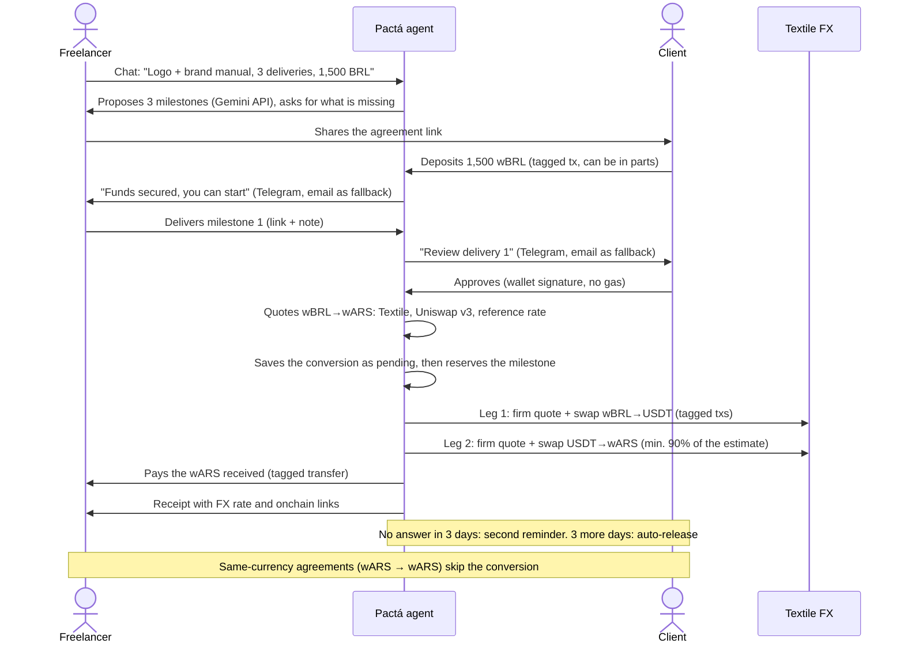
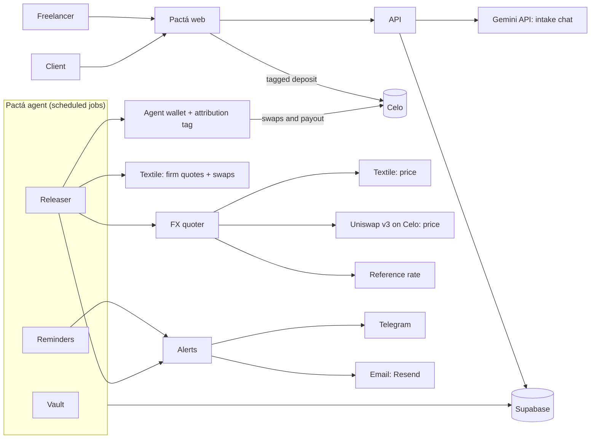
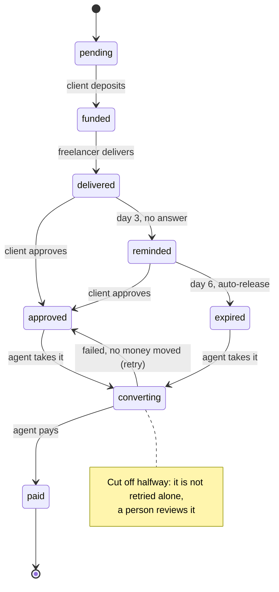

<p align="center">
  <picture>
    <source media="(prefers-color-scheme: dark)" srcset="docs/brand/pacta-logo-oscuro.svg">
    
  </picture>
</p>

<p align="center">
  <b>An AI agent that gets Latin American freelancers paid by milestones, across borders, without going through the US dollar.</b>
</p>

<p align="center">
  Built on Celo · Ripio wFIAT (wARS, wBRL, wMXN) · Textile FX · ERC-8004 · Gemini API
</p>

---

> **Status:** built for the [Agents on Open Rails](docs/hackathon/overview.md) hackathon (Loops House × Celo × Ripio). **Live on Celo mainnet** at [pacta-dun.vercel.app](https://pacta-dun.vercel.app): full milestone payments have run on mainnet with the team attribution tag — including a **cross-currency one**: the client deposited wARS and the freelancer was paid in wBRL, converted onchain by the agent through Textile (wARS → USDT → wBRL, no dollar account involved for the users). The agent also has an ERC-8004 identity. Only the demo video is still *pending*. **Reviewing this repo?** Jump to [Evidence for judges](#evidence-for-judges).

## The problem

A designer in Córdoba works for an agency in São Paulo. Today she gets paid in dollars: the client converts BRL → USD, she converts USD → ARS, and both lose money on spreads and platform fees. On top of that, she often delivers work and then waits weeks for the invoice to be paid, or it never is.

## What Pactá does

1. **The freelancer describes the job in plain words.** The agent (Gemini API) turns it into an agreement with milestones, amounts and review deadlines that she can edit.
2. **The client deposits the full amount upfront**, in their own Ripio stablecoin (for example wBRL). The agent holds it as a guarantee, so the freelancer knows the money is there before she starts.
3. **She delivers a milestone** with a link and a note. The client is notified (Telegram first, email as a fallback) to review it.
4. **The client approves** with a wallet signature (no gas).
5. **The agent gets the best FX quote**, converts that tranche through Textile (wBRL → USDT → wARS) and pays her. She gets a receipt with the rate, the amounts and the onchain transactions.
6. **If the client doesn't answer**, the agent sends a second reminder after 3 days, and after 3 more days (6 in total) it releases the payment on its own.

Same-currency agreements (wARS → wARS) work too, for clients and freelancers in the same country.



## How it works



| Module | What it does |
|---|---|
| Intake | Chat with the agent: free text → agreement with milestones, amounts and deadlines (Gemini API). It asks for whatever is missing. |
| Web | Create agreement, client link, deposit, deliver, approve, receipts. |
| Vault | Detects deposits to the agent wallet and tracks the balance per agreement. |
| FX quoter | Compares Textile, Uniswap v3 on Celo and a reference rate. Drops any route more than 15% away from the reference and picks the one that pays the freelancer the most. |
| Releaser | Pays approved or expired milestones exactly once. When the currencies differ it first converts through Textile in two legs (currency → USDT → currency), saving each leg as it goes. |
| Receipts | Matches database and chain to build a receipt for each payment. |
| Identity & tag | Single wallet client with the attribution tag, ERC-8004 registration, agent card. |
| Alerts | Telegram first, email (Resend) as a fallback, on every state change. |

Milestone lifecycle: `pending → funded → delivered → reminded (day 3) → approved | expired (day 6) → converting → paid`. `paused` exists as a status but nothing sets it yet.



For the MVP the agent wallet acts as the vault (no escrow contract), with a payout cap per milestone for each currency (`MAX_PAYOUT_PER_MILESTONE_ARS/_BRL/_MXN`; on mainnet the agent refuses to pay in a currency that has no cap). An onchain escrow contract is a stretch goal.

## Stack

| Layer | Technology |
|---|---|
| Language | TypeScript (strict) |
| Web + API | Next.js (App Router) on Vercel |
| UI | Tailwind + shadcn/ui |
| Blockchain | viem; wagmi in the browser (MiniPay, Valora, MetaMask) |
| Attribution | `@celo/attribution-tags` (ERC-8021) on every transaction |
| Identity | ERC-8004 Identity Registry on Celo |
| Tokens | Ripio wFIAT: wARS, wBRL, wMXN |
| FX | Textile (quotes and swaps), Uniswap v3 on Celo (quotes only) and a reference rate |
| AI | Gemini API |
| Database | Supabase (Postgres) |
| Scheduled jobs | Vercel Cron |
| Alerts | Telegram (official Bot API) + email with Resend |
| Gas | Paid in CELO by the agent wallet. The wallet client accepts `feeCurrency` per transaction (Celo fee abstraction) but we do not use it yet: all mainnet transactions so far paid gas in CELO |

## Onchain

| What | Address |
|---|---|
| Network | Celo mainnet (chain 42220) |
| wARS | [`0x0dc4f92879b7670e5f4e4e6e3c801d229129d90d`](https://celoscan.io/token/0x0dc4f92879b7670e5f4e4e6e3c801d229129d90d) |
| wBRL | [`0xd76f5faf6888e24d9f04bf92a0c8b921fe4390e0`](https://celoscan.io/token/0xd76f5faf6888e24d9f04bf92a0c8b921fe4390e0) |
| wMXN | [`0x337e7456b420bd3481e7fa61fa9850343d610d34`](https://celoscan.io/token/0x337e7456b420bd3481e7fa61fa9850343d610d34) |
| ERC-8004 Identity Registry | [`0x8004A169FB4a3325136EB29fA0ceB6D2e539a432`](https://celoscan.io/address/0x8004A169FB4a3325136EB29fA0ceB6D2e539a432) |
| Agent wallet (vault and payer) | [`0xab569A8d8A5b60CFfdf9B88EdE099c80d8328E73`](https://celoscan.io/address/0xab569A8d8A5b60CFfdf9B88EdE099c80d8328E73) |
| Agent ID (ERC-8004) | `10058` (owner: the agent wallet) |
| Agent card | [`pacta-dun.vercel.app/agent-card.json`](https://pacta-dun.vercel.app/agent-card.json) |
| Attribution tag | `celo_dc3ce5f39b37` (team tag, on every transaction the agent and the web send) |
| First real payment on mainnet: deposit (client → agent) | [`0x32a7…f6e0`](https://celoscan.io/tx/0x32a7ef0333f49a5b962cf7d269cafcf1b7f94200717210c26eab4ad8c4d5f6e0) |
| First real payment on mainnet: payout (agent → freelancer) | [`0xbd3c…5ec8`](https://celoscan.io/tx/0xbd3c9924040692c25c9e6c065d473808873cfcc5d916726bb829d7cad9225ec8) |

**First real cross-currency payment on mainnet** (3,000 wARS from the client → 10.05 wBRL to the freelancer, converted by the agent with Textile in two legs, wARS → USDT → wBRL; every transaction carries the team tag):

| Step | Transaction |
|---|---|
| Client deposit (3,000 wARS) | [`0xd05b…b922`](https://celoscan.io/tx/0xd05b84d72c9fcc589b44acc74cf24d6a258dc805f591a61c7a284c80e98eb922) |
| Leg 1: approval | [`0xa7b7…9aab`](https://celoscan.io/tx/0xa7b71d6bf2f45fa274beb828dcca337df589d27f71dd09440816c71328b09aab) |
| Leg 1: swap wARS → USDT (1.8073 USDT) | [`0x16b0…0168`](https://celoscan.io/tx/0x16b0f5fcefcee793ab918f945ceaff4450b2dfe47516995d6fabc658541c0168) |
| Leg 2: approval | [`0x8037…0634`](https://celoscan.io/tx/0x803747fce21451cd64b822a0702f949d51040c7cd64869f17f694927fc4b0634) |
| Leg 2: swap USDT → wBRL (10.054 wBRL) | [`0xd77e…21e5`](https://celoscan.io/tx/0xd77ebdbadd079aa6e9a790879ac76788b4652ecd4ed6760c9cb0e22ef92d21e5) |
| Payout to the freelancer (10.054 wBRL) | [`0xb717…6dba`](https://celoscan.io/tx/0xb717771dc5173d0e68a97c22d6440e70e3697eac9f88ce1232ce5b1b6dd6fba6) |

The agent only signs swap calldata that points at Textile's official contracts and an exact approval, and a conversion that stops halfway is resumed automatically by the agent (only the missing leg, never the one already done, with an attempt limit; see `npm run conversion:resume` for the manual version).

You can check the tag of any transaction with `NEXT_PUBLIC_CHAIN=celo npm run tag:verify -- <tx hash>` (read-only).

## Evidence for judges

Everything below is in this public repo (default branch `main`) and checkable on Celoscan.

| Question | Answer |
|---|---|
| Is it on mainnet? | Yes. Production runs with `NEXT_PUBLIC_CHAIN=celo` (chain 42220); the transaction hashes are in [Onchain](#onchain). Local development and PR previews run on Celo Sepolia, and a guard in the releaser (`onlyThisNetwork` in [`agent/releaser.ts`](agent/releaser.ts)) makes sure a testnet agreement can never be paid with mainnet money. |
| Which attribution tag? | `celo_dc3ce5f39b37`, the **team** tag shown on our Loops event page. It is set once in the single wallet client ([`lib/chain/wallet.ts`](lib/chain/wallet.ts), `withAttribution`) and in the browser deposit ([`lib/chain/deposit.ts`](lib/chain/deposit.ts), `dataSuffix`). Verify any hash: `NEXT_PUBLIC_CHAIN=celo npm run tag:verify -- <tx hash>`. |
| ERC-8004 identity | Registered on Celo mainnet from the agent wallet: **agentId `10058`** in the Identity Registry above. The card ([`public/agent-card.json`](public/agent-card.json)) carries the `agentId`, and `setAgentURI` points the on-chain identity to the published card. Registration script: [`scripts/register-agent.ts`](scripts/register-agent.ts) (`npm run agent:register`). |
| Where is the agent logic? | [`agent/`](agent): `vault.ts` (deposits), `reminders.ts` (day 3 and day 6), `releaser.ts` (approved/expired milestones, caps, idempotency), `resume-conversion.ts` (recovers a half-done swap). FX in [`lib/fx/`](lib/fx), chain in [`lib/chain/`](lib/chain), schema in [`supabase/migrations/`](supabase/migrations), API in [`app/api/`](app/api). |
| Tests | `npm test` (Vitest). Each test file is described in [`tests/README.md`](tests/README.md); the agent has its own suites in [`tests/agent/`](tests/agent). |

### Textile FX integration (the conversion step)

There is no direct wARS/wBRL corridor, so the agent converts in two legs through USDT, using Textile's RFQ API (`https://api.textilecredit.com/v2`):

1. **Indicative price** (`POST /rfq/preview`, free, no key): used by the quoter to compare routes ([`lib/fx/textile.ts`](lib/fx/textile.ts)). It is compared against Uniswap v3 on Celo and a reference rate, and any route more than 15% away from the reference is discarded.
2. **Firm quote** (`POST /rfq/request`) signed with a `takerProof` (EIP-712) from the agent wallet, then an exact token approval, then the swap, then wait for the receipt ([`lib/fx/textile-swap.ts`](lib/fx/textile-swap.ts)). Done once per leg, so 4 transactions per conversion, all tagged.
3. **Safety:** the calldata comes from Textile's API and is signed with the agent key, so it is only accepted if it targets Textile's official LimitOrderReactor / VaultOrderExecutor with value 0 and an exact approval ([`lib/chain/dex.ts`](lib/chain/dex.ts)). Leg 2 must return at least 90% of the estimate.

**Real example on mainnet** (the table in [Onchain](#onchain)): 3,000 wARS → 1.8073 USDT (leg 1) → 10.054 wBRL (leg 2), an effective 1 wARS ≈ 0.00335 wBRL. The same page links all six transactions. `npm run fx:quote -- wARS wBRL 3000` prints the live quotes of every route (read-only, no money moves).

### Autonomy: reminders, auto-release and payments

- `vercel.json` schedules `/api/cron/releaser` (09:00 UTC) and `/api/cron/vault` (09:30 UTC) once a day (the maximum on Vercel Hobby; Vercel sends `CRON_SECRET` as a Bearer token). The releaser first runs the reminders (`delivered` for 3 days → `reminded` with a second alert; 3 more days → `expired`, auto-release) and then pays everything `approved` or `expired`.
- Payment does not wait for the cron: when the client signs the approval, `POST /api/milestones/[id]/approve` pays right away.
- Payments are idempotent: a `pending` movement with a unique index per milestone is saved before any money moves, so running the task twice never pays twice. Each state change is recorded in `movements` and shown on the receipt.
- To watch the day-3 / day-6 logic in minutes instead of days, set `TIME_UNIT=minutes` (tests: [`tests/agent/reminders.test.ts`](tests/agent/reminders.test.ts)).
- Honest limit: the Hobby plan only allows daily crons, so a milestone can wait up to ~24 h after its deadline to be released. A recorded cron run and its transactions will be shown in the demo video.

### Who it is for and how a person with no wallet gets in

- **Target user:** freelancers in Argentina who bill clients in Brazil or Mexico (design, development, writing) and today lose several percent on BRL → USD → ARS plus platform fees, or wait weeks for an invoice. The percentages are not benchmarked yet, so we do not claim a figure; the receipt shows the real rate and amounts of every payment instead.
- **Screens:** amounts are shown in ARS / BRL / MXN, never in gas or hashes; texts are in plain Rioplatense Spanish. Mobile first: inside MiniPay the wallet connects by itself.
- **Wallet:** there is no login; the wallet is the identity. A person without one installs MiniPay (Opera Mini), Valora or MetaMask and the app opens the connect sheet; signatures (approve, deliver) cost no gas. The client only needs the stablecoin and a little CELO for the deposit. Wallet-less onboarding (email login) is planned, not built.
- **Real users:** we are onboarding independent freelancers and clients (wallets we did not create or fund) during the last week; counts and links will be added here once they are verified onchain, not before.

### Growth path after the hackathon

None of this is built yet; it is the order we plan to do it in.

**1. Solid base (first weeks)**
- Move production to its own Supabase project and replace the agent-wallet vault with an onchain escrow contract ([`docs/mainnet.md`](docs/mainnet.md)).
- Raise the payout caps step by step as the agent proves itself, and move the cron from daily to every few minutes.

**2. More wallets and an easier workflow**
- Support more wallets in the browser beyond MiniPay, Valora and MetaMask (for example WalletConnect-compatible wallets and Coinbase Wallet), so a client can pay from the wallet they already have.
- Email login with an embedded wallet, so a freelancer or a client with no crypto can start in under a minute. Today the wallet is the identity.
- Fewer steps: reusable agreement templates ("logo + brand manual"), a client link that needs no account to review and approve, and a repeat-client shortcut to open the next agreement in one tap.
- Keep alerts on the Telegram bot we already run, plus a WhatsApp option for users who do not use Telegram.

**3. Professional rebrand**
- A proper brand pass on top of the current logo ([`docs/brand/`](docs/brand/)): name and tagline tested with freelancers, a design system, and a landing page focused on one promise ("cobrá por hitos, sin pasar por el dólar").
- Receipts that look like documents a freelancer can show an accountant or a client's finance team, with the rate, the amounts and the onchain proof.
- A short public explainer in Spanish and Portuguese (the clients are in Brazil), and a status page for the agent.

**4. Marketing to win more clients**
- **Start where the pain is:** Argentine freelancer communities (design, development and writing groups on Telegram, Discord and LinkedIn) who already bill clients in Brazil or Mexico. Free first agreement in exchange for feedback and a public testimonial.
- **Give them a reason to bring the client:** every agreement link is a mini ad. The client sees the receipt, the rate and the guarantee, and may open their own agreement as the next freelancer's client.
- **Content that proves it:** publish real receipts (with permission) comparing what the freelancer got through Pactá against the BRL → USD → ARS route, and short videos of a full payment.
- **Partnerships:** Ripio and Celo communities, MiniPay's user base, and freelancer platforms and agencies in Brazil that pay LatAm talent.
- **Measure it:** agreements created, share of milestones paid, time from approval to payment, and returning clients, reviewed every week.
- **Revenue:** a small fee per released milestone, shown on the receipt next to the FX rate (not charged today).

## Run it locally

### 1. Requirements

- **Node.js 22.12 or newer.** The exact version is in [`.nvmrc`](.nvmrc); with [nvm](https://github.com/nvm-sh/nvm) (or [nvm-windows](https://github.com/coreybutler/nvm-windows)) run `nvm install` and `nvm use`. Check it with `node -v`.
- **Git.**
- Optional, only for the parts that touch the chain: a browser wallet (MetaMask, Valora or MiniPay) on Celo Sepolia.

### 2. Get the code

```bash
git clone https://github.com/marianelavflora/pacta.git
cd pacta
npm install
```

### 3. Environment variables

```bash
cp .env.example .env.local
```

Fill in `.env.local`. Git ignores it, so your keys never reach the repo. Every variable has a comment in [`.env.example`](.env.example); this is where each value comes from:

| Variable | Where to get it |
|---|---|
| `NEXT_PUBLIC_CHAIN` | Leave `celo-sepolia` (testnet). `celo` is mainnet. |
| `NEXT_PUBLIC_ATTRIBUTION_TAG` | The team's attribution tag (see [`AGENTS.md`](AGENTS.md)). |
| `AGENT_PRIVATE_KEY` | Agent wallet key. Only the maintainer has it; leave it empty unless you work on payments. |
| `SUPABASE_URL` | Supabase → Project Settings → Data API → Project URL. |
| `SUPABASE_SERVICE_ROLE_KEY` | Supabase → Project Settings → API Keys → the **secret** key (`sb_secret_...`) or the legacy `service_role`. Never the publishable/anon key. |
| `SUPABASE_DB_URL` | Supabase → **Connect** → Connection string. Only needed to run migrations from scripts. |
| `GEMINI_API_KEY` | [aistudio.google.com](https://aistudio.google.com) → Get API key (free tier). Server only. |
| `TELEGRAM_BOT_TOKEN` | The bot token from [@BotFather](https://t.me/BotFather). See [`docs/telegram.md`](docs/telegram.md). |
| `RESEND_API_KEY` | [resend.com](https://resend.com) → API Keys. |
| `CRON_SECRET` | Any long random string, for example `openssl rand -hex 32`. |
| `TIME_UNIT` | `days` (real deadlines) or `minutes` (to test reminders and auto-release fast). |
| `TELEGRAM_WEBHOOK_SECRET` | A long random string you choose (letters, digits, `_` and `-`). Protects the bot webhook. |
| `NEXT_PUBLIC_TELEGRAM_BOT_USERNAME` | The bot username without `@`. Shows the "Get alerts on Telegram" button. |

You only need the variables of the part you are working on: the home page runs with an empty `.env.local`.

**Test CELO.** To try deposits on testnet, get free CELO for your wallet at [faucet.celo.org](https://faucet.celo.org) (pick Celo Sepolia). It is play money with no real value.

### 4. Database

The tables live in [`supabase/migrations/`](supabase/migrations/). To create them in your Supabase project:

1. Open Supabase → **SQL Editor** → **New query**.
2. Paste the content of each file **in order** (`0001_...`, then `0002_...`, and so on) and click **Run**.
3. Check them in **Table Editor**: `users`, `agreements`, `milestones`, `movements`, `quotes`.

The migrations are safe to run more than once.

### 5. Run it

```bash
npm run dev     # app at http://localhost:3000
npm test        # tests (Vitest)
npm run lint    # code style (ESLint)
npm run build   # production build, the same one Vercel runs
```

Before opening a PR, `npm run lint`, `npm test` and `npm run build` must pass.

### Common problems

| Problem | Fix |
|---|---|
| `npm install` fails or warns about `engines` | Your Node is too old. Run `nvm use` (or install Node 22.12+) and try again. |
| `npm run dev` says port 3000 is in use | Another app is using it. Close it, or open the URL Next.js prints (usually `http://localhost:3001`). |
| A variable is `undefined` | Check the name matches `.env.example`, the file is called `.env.local` (not `.env.local.txt`) and sits in the project root. Restart `npm run dev` after changing it. |
| Supabase says `Invalid API key` or `permission denied` | You used the publishable/anon key. Use the secret (`sb_secret_...`) or `service_role` key. |
| SQL Editor says a table does not exist | You ran the migrations out of order. Run them again from `0001`. |
| The wallet shows no CELO on testnet | Make sure it is on Celo Sepolia, not mainnet, and ask the faucet again. |
| Something is odd after pulling new changes | Delete `node_modules` and `.next`, then run `npm install` again. |

If you get stuck, ask in the team chat with the exact error message. The team workflow (branches, PRs) is in [`docs/WORKFLOW.md`](docs/WORKFLOW.md), in Spanish.

## Demo

*Pending (PAC-52).* Link to the 2–3 minute video of a real cross-border payment on mainnet.

## Team

| | Focus |
|---|---|
| Mavi ([@marianelavflora](https://github.com/marianelavflora)) | Agent, wallet, blockchain, payments, FX, AI |
| Flor | Frontend: UI, wallet connection, views, receipts, mobile |
| Leila ([@leispini](https://github.com/leispini)) | Database, API, FX research, tests |
| Clau ([@ClaudiaRivero863](https://github.com/ClaudiaRivero863)) | Forms, intake UI, Telegram, email, "How it works" page |

## Docs

- [`docs/PLAN.md`](docs/PLAN.md): the living development plan (in Spanish).
- [`AGENTS.md`](AGENTS.md): context and rules for the team and for AI agents working in this repo.
- [`docs/README.md`](docs/README.md): index of all the documentation.

## License

[MIT](LICENSE)
