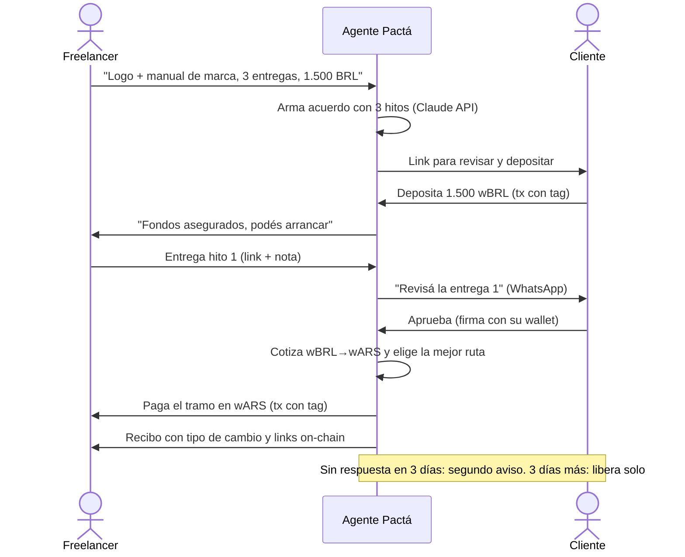
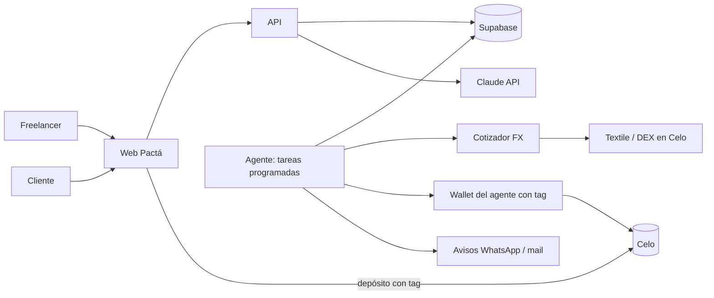

# Plan de Pactá

Plan de desarrollo vivo. Si cambia una decisión, se actualiza acá en el mismo PR que la cambia (y se anota en `AGENTS.md`, sección "Estado y decisiones").

## La idea

**Un agente que cobra trabajos por hitos entre países, sin pasar por el dólar.** El cliente deposita al principio en su moneda (por ejemplo wBRL) y la plata queda guardada. Cada vez que se aprueba una entrega, el agente cotiza, convierte y le paga ese tramo a la freelancer en wARS. Si el cliente no responde, el agente le recuerda y, si sigue sin responder, libera el tramo solo.

- Track principal: Stable Agents LatAm (Ripio × Celo, US$1.500 / 500).
- Track secundario: Open Corridors · Textile FX (US$750 / 250), porque cada liberación es una operación de cambio real.

### Cómo se mezclan las dos ideas de Lei

| Idea A: cobro cross-border sin dólar | Idea B: cobro por hitos con garantía | Pactá |
|---|---|---|
| Pago en la moneda del cliente, mejor tipo de cambio, conciliación | Depósito por adelantado, liberación por hito, auto-liberación | Hitos con garantía y FX en cada liberación, así la freelancer cobra al tipo de cambio del día |

Para bajar el riesgo de la idea B:
- **MVP:** la wallet del agente hace de bóveda, con un tope por acuerdo. Todo movimiento queda on-chain y en el recibo.
- **Extra (PAC-54):** contrato de garantía con OpenZeppelin, solo si el MVP ya funciona con usuarios reales.
- También se aceptan acuerdos **en la misma moneda** (wARS → wARS), para sumar usuarios de Argentina aunque no haya clientes en Brasil a tiempo.

## Usuarios y flujo

- **Freelancer:** quien cobra. Ejemplo: una diseñadora en Córdoba que trabaja para una agencia en São Paulo.
- **Cliente:** quien paga. Deposita en su moneda y aprueba entregas.
- **Agente Pactá:** arma el acuerdo, guarda la plata, cotiza, convierte, paga, avisa y emite recibos.

## Requisitos

### Funcionales

| ID | Requisito | Prioridad |
|---|---|---|
| RF-01 | La freelancer conecta su wallet de Celo (MiniPay, Valora o MetaMask) y crea un acuerdo. | MVP |
| RF-02 | Describe el trabajo en texto libre y el agente propone hitos, montos y plazos editables. | MVP |
| RF-03 | El acuerdo define moneda del cliente (wBRL, wMXN, wARS) y moneda de cobro (wARS por defecto). | MVP |
| RF-04 | El cliente abre un link, ve el acuerdo y una cotización de referencia, y deposita el total. | MVP |
| RF-05 | El agente detecta el depósito y marca el acuerdo como financiado. | MVP |
| RF-06 | La freelancer marca un hito como entregado, con link y nota. | MVP |
| RF-07 | El cliente aprueba con una firma de su wallet (sin gas). | MVP |
| RF-08 | Al aprobarse, el agente cotiza, convierte si hace falta y paga el tramo. | MVP |
| RF-09 | Sin respuesta en 3 días: segundo aviso. Sin respuesta 3 días más (6 en total): libera solo. Plazos configurables. | MVP |
| RF-10 | Cada pago genera un recibo con montos, tipo de cambio, referencia y links on-chain. | MVP |
| RF-11 | Avisos por WhatsApp (y mail de respaldo) en cada cambio de estado. | Deseable |
| RF-12 | El cliente puede pausar un hito; la disputa se resuelve a mano. | Deseable |
| RF-13 | El agente resume la entrega para el cliente. | Deseable |
| RF-14 | Contrato de garantía on-chain en lugar de la bóveda. | Extra |
| RF-15 | Devolución de hitos no entregados si el cliente cancela. | Extra |

### No funcionales

| ID | Requisito |
|---|---|
| RNF-01 | Testnet (Celo Sepolia) hasta el 4 nov; desde ahí, Celo mainnet (42220). La red es una sola variable. |
| RNF-02 | Toda transacción, del agente y del cliente desde la web, sale con el tag del equipo. |
| RNF-03 | Pantallas entendibles para alguien que nunca usó crypto. |
| RNF-04 | La clave del agente vive solo en el servidor como variable secreta. |
| RNF-05 | Tope por acuerdo y tope diario de pagos del agente. |
| RNF-06 | Pagos idempotentes: nunca se paga dos veces el mismo hito. |
| RNF-07 | Repo público con README claro (una IA revisa el repo para el jurado). |
| RNF-08 | Gas pagado en stablecoin con `feeCurrency`. |

## Arquitectura y módulos

| Módulo | Qué hace |
|---|---|
| M1 Acuerdos (intake) | Texto libre → acuerdo con hitos, montos y plazos (Claude). |
| M2 Web | Crear acuerdo, link del cliente, depositar, entregar, aprobar, recibos. |
| M3 Bóveda | Detecta depósitos a la wallet del agente y lleva el saldo por acuerdo. |
| M4 Cotizador FX | Textile + DEX de respaldo + referencia; elige el mejor precio. |
| M5 Liberador | Paga hitos aprobados o vencidos, convierte si hace falta, una sola vez. |
| M6 Recibos | Cruza base y cadena, arma el recibo de cada pago. |
| M7 Identidad y tag | Cliente de wallet único con tag, registro ERC-8004, agent card. |
| M8 Avisos | WhatsApp y mail en cada cambio de estado. |

## Datos

- **Usuaria:** wallet, nombre, número de WhatsApp (con permiso) y mail de respaldo.
- **Acuerdo:** freelancer, cliente, descripción, moneda del cliente, moneda de cobro, total, estado, link público.
- **Hito:** acuerdo, orden, título, monto, plazos de revisión, estado, link de entrega, fechas.
- **Movimiento:** hito o acuerdo, tipo (depósito, conversión, pago, devolución), monedas, montos, tipo de cambio, hash, estado.
- **Cotización:** par, ruta, precio, referencia, hora.

Vida de un hito: `pending → funded → delivered → reminded (día 3) → approved | expired (día 6) → converting → paid`. Desde `delivered` el cliente puede pasarlo a `paused`. El cliente puede aprobar en cualquier momento.

## Fases y sprints

| Sprint | Fechas | Fases | Termina con |
|---|---|---|---|
| 1 · Base y núcleo | 26–31 oct | 0 Preparación, 1 Núcleo en la misma moneda | Un acuerdo por hitos de punta a punta en testnet (PAC-01 a PAC-28) |
| 2 · Cross-border y mainnet | 1–5 nov | 2 FX, 3 Mainnet y agente con IA | MVP completo en mainnet (PAC-29 a PAC-46). **Paso a mainnet: mié 4 nov, fecha fija** |
| 3 · Usuarios reales y entrega | 6–8 nov | 4 Usuarios y pulido, 5 Entrega | Usuarios independientes, demo y entrega en los dos tracks (PAC-47 a PAC-54) |

Office Hours: jueves 29 oct y 5 nov, 09:00 ART.

## Fuera de alcance

- Arbitraje automático de disputas.
- Facturación fiscal o integración con bancos.
- App móvil nativa (la web tiene que andar en el celular y en MiniPay).
- Monedas fuera de las wFIAT de Ripio.
- Montos grandes (hay tope durante la hackathon).

## Riesgos

| Riesgo | Qué hacemos |
|---|---|
| No hay liquidez wBRL→wARS | Se verifica en PAC-08. Si no hay par directo, se rutea por un intermedio. Si no hay ruta, el MVP queda en misma moneda. |
| No sabemos cómo se integra Textile | Telegram del hack y Office Hours del 29 oct. |
| Pocos usuarios independientes | Se buscan desde el sprint 1. Meta: mínimo 10, ideal 20. |
| Transacciones sin tag | Un único cliente de wallet con tag; revisar cada tx nueva en el explorador. |
| Se filtra la clave del agente | Solo como secreto en Vercel, topes y saldo bajo. |
| Meta tarda en aprobar WhatsApp | Se pide en el sprint 1; mientras, sandbox de Twilio y mail. |
| Poco tiempo en mainnet | El paso a mainnet del 4 nov no se mueve. |
| Equipo nuevo en web3 | Tickets chicos, explicaciones simples, contrato como extra. |
