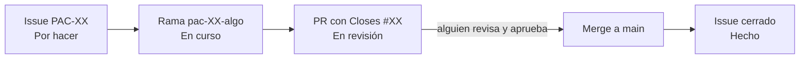

# Cómo trabajamos: issues, ramas y PRs

Guía corta para el día a día. Si es tu primera vez con Git y GitHub, leela entera; después te queda de machete.

## La idea en una imagen

Pensalo como una cocina con una sola olla grande (`main`) que tiene que estar siempre rica:

- Cada **issue** es una receta para preparar algo chico: "hacé el botón de conectar wallet".
- Cada **rama** es tu tabla de cortar: preparás ahí sin tocar la olla.
- El **PR** (pull request) es cuando le decís a otra: "probá esto antes de que lo echemos en la olla".
- **Mergear** es echarlo en la olla. Ahí el issue se cierra solo y en el tablero pasa a **Hecho**.



## Dónde está cada cosa

| Qué | Dónde |
|---|---|
| Qué hay que hacer | Los **issues** del repo (PAC-01 a PAC-54). El número del issue es el del ticket: PAC-14 es el issue #14. |
| Quién hace qué y en qué estado está | El **tablero** de GitHub Projects. Filtrá por tu nombre. |
| Cómo es el proyecto y qué reglas hay | [`AGENTS.md`](../AGENTS.md) y [`docs/PLAN.md`](PLAN.md). |
| El código que funciona | La rama `main`. |

Las etiquetas de cada issue dicen el sprint (`sprint-1`, `sprint-2`, `sprint-3`) y la persona (`mavi`, `flor`, `leila`, `clau`, `todas`).

## Paso a paso de un ticket

### 1. Elegí un issue

- Entrá al tablero, filtrá por tu nombre y elegí uno de **Por hacer**.
- Mirá la sección **"Depende de"** del issue. Si alguno de esos tickets no está en **Hecho**, todavía no podés arrancar (o arrancá la parte que no depende y avisá).
- Movelo a **En curso**. Así las demás saben que lo tenés vos.

### 2. Traé lo último de `main` y creá tu rama

```bash
git checkout main
git pull
git checkout -b pac-14-api-crear-acuerdo
```

El nombre de la rama siempre es `pac-` + número del ticket con dos cifras + dos o tres palabras: `pac-04-guia-instalacion`, `pac-12-boton-wallet`.

### 3. Trabajá y guardá de a poco

Cada vez que algo ande, hacé un commit (una "foto" del avance):

```bash
git add .
git commit -m "Formulario de hitos: agregar y sacar filas"
git push -u origin pac-14-api-crear-acuerdo   # la primera vez
git push                                      # las siguientes
```

Commits chicos y con un mensaje que diga qué cambió. Mejor diez commits chicos que uno gigante.

### 4. Abrí el PR

- En GitHub te aparece un botón amarillo **"Compare & pull request"**. Tocalo.
- El PR ya viene con una plantilla. En la primera línea completá `Closes #14` (el número de tu issue). Eso es lo que hace que el issue se cierre solo al mergear.
- Completá la plantilla en formato APB: qué cambia en palabras simples, cómo se prueba paso a paso y las palabras nuevas. Tiene que entenderla alguien que no vio tu código.
- En **Reviewers** elegí a alguien del equipo. Si tocaste wallet, pagos, liberador o FX, tiene que ser **Mavi**.
- En el tablero, el ticket pasa a **En revisión**.

¿No terminaste pero querés que alguien mire? Abrilo como **Draft** ("borrador").

### 5. Revisión

Quien revisa:

- Lee los cambios en la pestaña **Files changed**.
- Si puede, baja la rama y la prueba (`git fetch` y `git checkout pac-14-...`).
- Deja comentarios o aprueba con **Approve**.

Si te piden cambios, los hacés en la misma rama y hacés `git push`. El PR se actualiza solo, no hace falta abrir otro.

### 6. Merge

- Con una aprobación, cualquiera del equipo puede mergear con **"Squash and merge"** (junta todos tus commits en uno prolijo).
- Después de mergear, borrá la rama con el botón **Delete branch**.
- El issue se cierra solo y pasa a **Hecho**.

## Reglas de oro

1. **Nunca se pushea directo a `main`.** Todo entra por PR, aunque sea un typo.
2. **Un ticket, una rama, un PR.** Si ves algo para arreglar que no es de tu ticket, abrí un issue nuevo.
3. **Nada de claves en el código.** Van en `.env.local`, que Git ignora. Si subiste una sin querer, avisale a Mavi en el momento.
4. **Lo que toca plata lo revisa Mavi.**
5. **Si cambia una decisión** (una dirección, una variable, el flujo), actualizá `AGENTS.md` y `docs/PLAN.md` en el mismo PR.

## Cuando algo se complica

**"Me dice que hay conflictos."** Alguien cambió el mismo archivo que vos. Traé lo nuevo de `main` a tu rama:

```bash
git checkout main
git pull
git checkout pac-14-api-crear-acuerdo
git merge main
```

Git te marca los pedazos en conflicto con `<<<<<<<` y `>>>>>>>`. Dejá la versión correcta, borrá las marcas, y hacé commit y push. Si no sabés cuál dejar, preguntá a quien hizo el otro cambio.

**"Hice commits en `main` sin querer."** No hagas push. Creá la rama desde donde estás (`git checkout -b pac-XX-algo`), pusheá esa rama y avisá para dejar `main` como estaba.

**"Estoy trabada."** Comentá en el issue qué intentaste y dónde se rompe, y avisá por WhatsApp. Si usás un agente de IA (Claude Code, Cursor, Orca), arrancá con la frase de [`AGENTS.md`](../AGENTS.md) ("Primera vez: la frase para arrancar"): lee las reglas, te dice cuál es tu próximo ticket y te cuenta el plan antes de tocar código.

## Ritmo del equipo

- **Mini standup** por WhatsApp a la mañana (opcional): qué hice ayer, qué hago hoy, en qué estoy trabada.
- **Cierre de sprint:** sprint 1 el 31 oct, sprint 2 el 5 nov, sprint 3 y entrega el 8 nov.
- **Paso a mainnet:** miércoles 4 nov, fecha fija.
